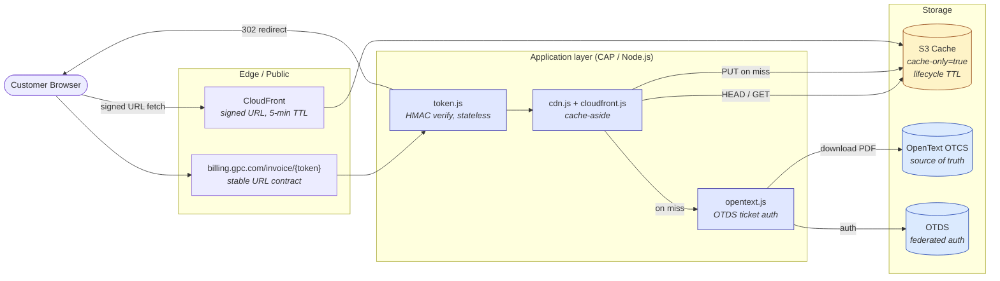
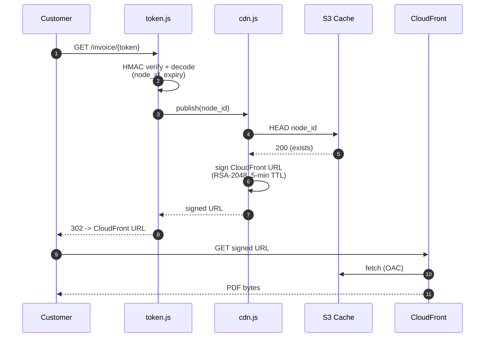
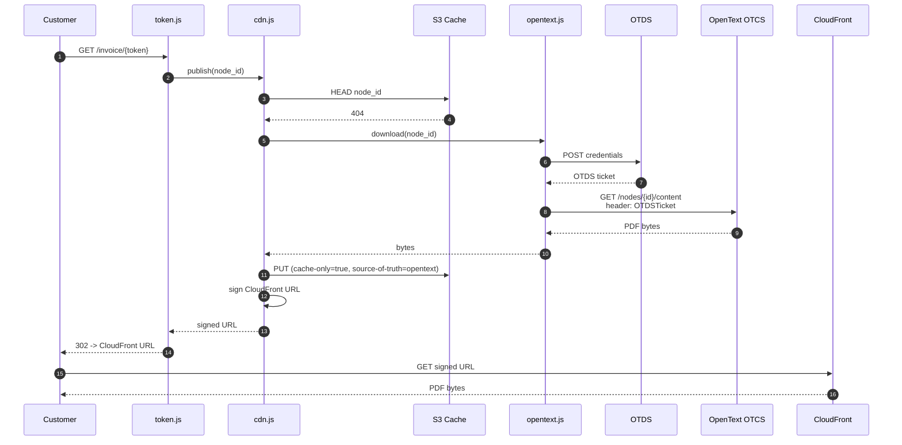

# Architecture Diagrams — System Design Walkthrough

Three views for explaining the prototype to the team, interview-style.

> **Tip:** copy any of the ```mermaid blocks below into [excalidraw.com](https://excalidraw.com) via **Menu → Generate → Mermaid to Excalidraw** to get the whiteboard look.

---

## 1. Component view — who talks to whom



---

## 2. Cache HIT — the hot path (the pitch)

This is the 99% case after warm-up. Three hops, no OpenText touch.



---

## 3. Cache MISS — the cold path

First fetch per document. Pays the OpenText cost once, then it's cached.



> CloudFront URL signing lives in `srv/lib/cloudfront.js`; the S3 cache-aside read/write-through lives in `srv/lib/cdn.js`. The Python prototype's single `cdn_publisher.py` is split into those two modules on the CAP side.

---

## Talking points (interview-style)

**Why this shape:**
- **S3 is a cache, not a store.** `cache-only=true` tag + lifecycle policy + `source-of-truth=opentext` metadata. OpenText remains authoritative. Compliance-friendly.
- **Stable customer URL ≠ asset URL.** The `/invoice/{token}` contract never changes; signed CloudFront URLs are minted fresh per request and expire in 5 minutes.
- **Stateless tokens (HMAC).** No session store, no DB lookup on the redirect path — horizontal scale is trivial.
- **Auth gotcha worth a slide.** In CE 25.4 with OTDS federation, the `OTCSTicket` response header is **not** a valid standalone credential. We send `OTDSTicket` on every OTCS call. Discovered the hard way (see `docs/endpoint-discovery.md`).

**What we measured:** `benchmarks/run-*.json` (prototype script) — cold path includes the OpenText hop; warm path is ~CloudFront latency only.

**What we deliberately did NOT build:** async, a web framework in `srv/`, a session store, signed-URL caching. All would obscure the architecture decision under review.

---

> **Origin:** Imported from the OpenText CDN Python prototype (`opentext-cdn-prototype`). This is the consolidated, self-contained copy — the prototype repo is archival. Benchmark/latency figures are from the prototype's May 2026 measurement run and have not been re-measured against the CAP implementation. See [docs/README.md → Origins & related work](README.md#origins-and-related-work) for the prototype's role.
